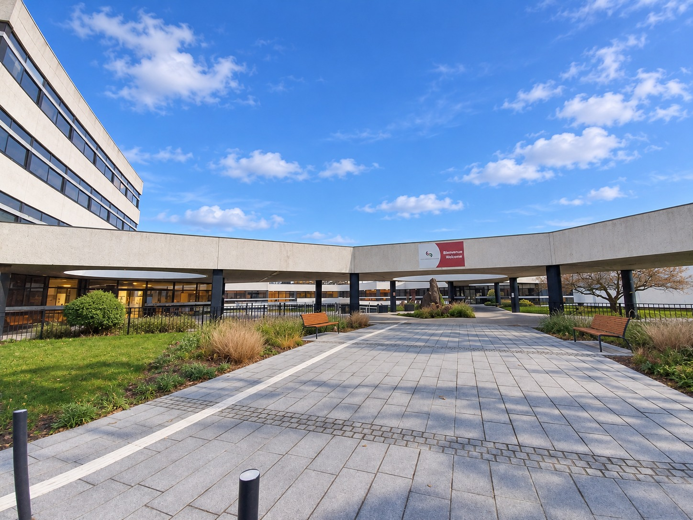

<!--
  ================================================================
  BIENVENUE !
  Tout ton rapport s'écrit dans CE fichier.

  Pour voir ton site web : clique sur le bouton "Preview" en haut
  à droite (ou Ctrl+Maj+K). Il se met à jour à chaque sauvegarde.

  Pour fabriquer le rapport Word : Ctrl+Maj+P, tape
  "Quarto: Preview Format", puis choisis "docx".

  Les blocs gris comme celui-ci sont des commentaires : ils n'apparaissent nulle part. Ce sont des conseils
  pour toi, tu peux les supprimer au fur et à mesure.

  Remplace tout ce qui est entre [crochets].
  ================================================================
-->

::: {.callout-note title="Mon stage en bref"}
**Stagiaire :** Olivier Castan, élève de 3ème au collège JP Vernant\
**Lieu du stage :** CentraleSupélec, Rennes\
**Dates :** du lundi 23/11 au vendredi 27/11/2026\
**Tuteur :** Simon Leglaive, Enseignant chercheur
:::

# Introduction 
<!--Présente-toi en quelques lignes : ce que tu aimes, tes matières préférées,
ce que tu aimerais faire plus tard...

Explique ensuite comment tu as trouvé ce stage, et pourquoi tu l'as choisi.
Qu'est-ce que tu espérais découvrir ?-->

## Ma recherche de stage 
J'ai connu cette institution par relation familiale. Pour l'obtention du stage, je suis passé par l'envoi d'un mail de demande de stage.\
\
J'attendais de ce stage de découvrir la vie dans les écoles d'ingénieurs, et découvrir le métier d'enseignant-chercheur.

# Le lieu de stage

## Présentation générale

- **Nom :** CentraleSupélec
- **Adresse :** 1 avenue de la Boulaie, Cesson-Sévigné
- **Domaine d'activité :** Enseignement supérieur et recherche

{#fig-batiment width=80%}

## Les métiers et l'organisation
### Les employés et les horaires de travail
Nombre d'employés sur le campus : 80\
Femmes : 22\
Hommes : 58\

::: {.callout-tip title="Horaires de travail et congés"}
Un enseigant-chercheur doit travailler environ 1600 heures par an, dont : \
- 800 heures de recherche ; \
- 800 heures d'enseignement, dont 25% (200 heures) face aux élèves. \
Ils font entre 35 et 40 heures par semaine et il leur reste donc 5 à 8 semaines de congés. \
:::

### Les métiers
#### Organigrammes {.unnumbered}

{#fig-Orgcampus width=100%}

{#fig-admin width=100%}

{#fig-labo width=100%}

#### Les métiers et leurs activités {.unnumbered}

| Métier              | Activités              |
|---------------------|------------------------|
| Enseignant-chercheur| Produire des connaissances et les transmettre|
| Post-doctorant      | Produire et diffuser des connaissances  |
| Assisstant de direction|Administrer |
| Assisstant de scolarité |Administrer |
: Les métiers et leurs activités {#tbl-métiers}

<!--
  Pour faire référence à une image ou un tableau, donne-lui une étiquette
  qui commence par #fig- ou #tbl- (voir au-dessus), puis écris @fig-...
  ou @tbl-... dans ton texte : le numéro se met tout seul. Saute une ligne entre chaque
-->

# Mon journal de bord

<!--
  Remplis un jour à la fois, idéalement le soir même : on oublie vite !
-->

## Lundi 23/11

**Ce que j'ai fait :** Visite de l'amphithéâtre (voir @fig-amphi), j'ai aussi assisté à des réunions recherche.

**Ce que j'ai appris :** Renaud S. m'a présenté les start up qu'il a cofondées.

::: {.callout-tip title="Le mot du jour"}
Start up : Petite entreprise naissante dans les secteurs technologiques, le but étant d'être le premier sur le marché, et au final se faire racheter la start up. Par exemple, Renaud S. m'a présenté une Startup appelée AIMAC, qui avait pour but de détecter des émotions à l'aide d'une image du visage,ou recréer des visages extrêmement réalistes dotés d'émotions. Cette Startup a au final été rachetée par Rockstar Games (Jeux GTA)
:::

{#fig-amphi width=60%}

## Mardi 24/11

**Ce que j'ai fait :** Aide à la mise en place d'un atelier pour les étudiants internationaux, échange avec Tiphaine à propos d'une start up

**Ce que j'ai appris :** Découverte du BrevetAI, un site de formation à l'intelligence artificielle

::: {.callout-important title="Ce qui m'a surpris"}
J'ai appris que dans les élèves de tous les campus de CentralSupélec, plus de 70 nationalités différentes sont représentées.
:::

## Mercredi 25/11

**Ce que j'ai appris :** J'ai suivi une formation sur les impacts environnementaux directs et indirects de l'Intelligence artificielle, et j'ai assisté à un cours de Simon L. sur le machine learning

::: {.callout-note title="Impacts environnementaux directs et indirects de l'IA"}
- Les impacts environnementaux directs de l'intelligence artificielle sont les impacts liés au cycle de vie des équipements numériques, notamment lors de leur extraction et de leur distribution, mais aussi lors de leur utilisation, comme la haute consommation en eau des serveurs.
- Les impacts environnementaux indirects de l'intelligence artificielle sont les impacts que l'IA a sur d'autres secteurs, sur les écosystèmes ou sur les comportements humains; ces impacts ne sont pas causés directement par cette activité mais en résultent de manière indirecte. Par exemple, si on intègre une IA dans une voiture afin qu'elle optimise les trajets pour qu'ils limitent la consommation de la voiture, cela peut amener les utilisateurs à utiliser plus souvent leur voiture car ils auront moins d'essence à payer, et donc obtenir l'effet inverse. Cependant, si les utilisateurs n'utilisent pas plus leur voiture malgré ce progrès, alors l'impact indirect sera positif pour l'environnement.
::: 